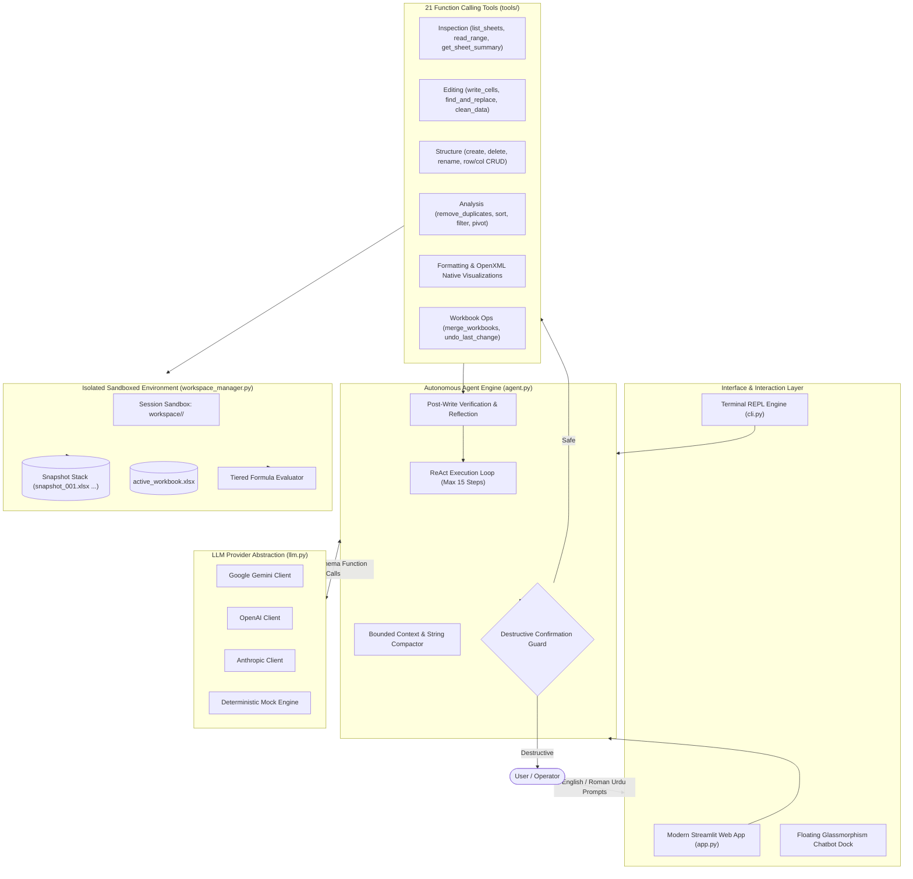

<div align="center">

# 📊 Excel AI Agent
### *Autonomous Multilingual Spreadsheet Intelligence Engine*

[](https://excel-agent-ai.streamlit.app/)
[](SPEC.md)
[](https://python.org)
[](SPEC.md)
[](https://excel-agent-ai.streamlit.app/)
[](SPEC.md#5-safety-sandboxing--integrity-architecture)
[](https://opensource.org/licenses/MIT)

<br/>

### 🌐 **[👉 Open Live Interactive Web App (excel-agent-ai.streamlit.app)](https://excel-agent-ai.streamlit.app/)**

[🎮 Live Web App](https://excel-agent-ai.streamlit.app/) • [📋 System Architecture & SPEC](SPEC.md) • [🧠 The Agentic Paradigm](#-the-agentic-paradigm) • [🌟 Core Capabilities](#-core-autonomous-capabilities) • [🏗️ System Architecture](#%EF%B8%8F-agentic-system-architecture) • [💬 Prompts Showcase](#-multilingual-prompt-showcase) • [🧰 Tools Registry](#-21-autonomous-tools-registry) • [🐍 Python SDK Usage](#-programmatic-agent-sdk-usage) • [🚀 Quickstart](#-quickstart--local-setup) • [🧪 Testing](#-testing--verification)

---

</div>

## 💡 The Agentic Paradigm

Traditional chatbots and generic LLM wrappers fail when interacting with spreadsheets: they attempt to write entire scripts via code-interpreters, hallucinate CSV rows, overwrite existing OpenXML formulas, or crash with context window overflows.

**Excel AI Agent** implements a deterministic **Agentic Tool-Use Architecture** (ReAct pattern) designed specifically for production data manipulation:

```text
                  ┌──────────────────────────────────────────────┐
                  │          Natural Language Prompt             │
                  │       (English or Roman Urdu query)          │
                  └──────────────────────┬───────────────────────┘
                                         ▼
                  ┌──────────────────────────────────────────────┐
                  │           Perception & Language              │
                  │    Extracts intent, preserves user idiom     │
                  └──────────────────────┬───────────────────────┘
                                         ▼
     ┌────────────────────────────────────────────────────────────────────────┐
     │                     AUTONOMOUS AGENT REASONING CORE                    │
     │                                                                        │
     │  1. INSPECTION FIRST: Reads workbook schema, headers & data types     │
     │  2. ACTION PLANNING: Selects optimal sequence from 21 specialized tools│
     │  3. DYNAMIC FORMULAS: Synthesizes live Excel expressions (=SUM, =IF)  │
     │  4. SAFETY INTERCEPT: Pauses on destructive operations for approval    │
     │  5. VERIFICATION: Re-reads written cells & self-corrects on syntax err │
     └───────────────────────────────────┬────────────────────────────────────┘
                                         ▼
                  ┌──────────────────────────────────────────────┐
                  │          Sandboxed OpenXML Workspace         │
                  │  (Pre-mutation snapshots, 1-step undo stack) │
                  └──────────────────────────────────────────────┘
```

> [!TIP]
> **Zero Data Loss Guarantee**: The user's original file is marked read-only and preserved untouched. All operations execute inside an isolated session directory (`workspace/<session_id>/`) with automated incremental version snapshots.

---

## 🌟 Core Autonomous Capabilities

### 1. 🌐 Native Roman Urdu & English Understanding
Understands real-world colloquial spreadsheet commands in Roman Urdu without requiring formal grammar:
- *"Total sales nikalo aur formula H25 mein likh do"* ➔ Inspects headers, locates `Total_Revenue`, writes `=SUM(H2:H24)`.
- *"Order_ID ke hisaab se duplicates hata do"* ➔ Samples duplicates, displays interactive confirmation card, purges only after user consent.
- *"Region ke hisaab se sales ka column chart banao"* ➔ Extracts categories, creates native OpenXML Column Chart.

### 2. 🛡️ Human-in-the-Loop (HITL) Bound Safety Guards
Destructive actions (`delete_sheet`, `delete_rows`, `delete_columns`, `remove_duplicates`) cannot execute autonomously without explicit approval. The agent calculates the exact blast radius, halts execution, and binds the approval token to strictly prevent the LLM from altering parameters upon execution.

### 3. ⚡ Tiered Live Formula Engine
Spreadsheet changes reflect real-time computed outputs in the UI:
- **Tier 1 (Pure Python AST)**: Evaluates functions like `SUM`, `AVERAGE`, `IF`, `COUNTIF`, and nested algebra in-memory via `formulas`.
- **Tier 2 (Headless LibreOffice)**: Invoked when present on `PATH` for multi-sheet external dependencies.
- **Tier 3 (Safe Regex & Fallback)**: Arithmetic evaluation and graceful degradation ensuring error codes (`#DIV/0!`, `#N/A`) never crash JSON serialization.

### 4. 🔄 Granular Single-Step Reversible Undo Engine
Every modifying action triggers `WorkspaceManager.create_snapshot()`. Clicking **Undo** restores the exact state before the last tool execution, with a live undo counter in the UI.

### 5. 🧠 Bounded Context Window & Auto-Compaction
Large files with 50,000+ rows are safely inspected through intelligent header scanning and subset sampling. Tool results are capped at `4,000 characters` with sliding conversational history to prevent LLM token exhaustion.

### 6. 🔌 Provider-Agnostic LLM Engine
Switch providers dynamically at runtime or evaluate completely offline:
- **Google Gemini**: `gemini-3.8-flash` (Fast, native function calling)
- **OpenAI**: `gpt-4o` / `gpt-4o-mini`
- **Anthropic**: `claude-3-5-haiku-20241022`
- **Mock Evaluator**: Deterministic offline mode for testing and demonstrations without API keys.

---

## 🏗️ Agentic System Architecture



---

## 📸 Interface Preview & Tool Execution Traces

<div align="center">

| Main Application Canvas | Live Tool Execution Traces |
|:---:|:---:|
| Interactive spreadsheet viewer with real-time evaluated formulas, status metrics, and download triggers. | Transparent collapsible step-by-step reasoning traces showing tool arguments, return data, and execution timing. |

</div>

> [!NOTE]
> Free tier Streamlit Community Cloud apps may sleep after inactivity. If you see a sleep prompt on the live link, click **"Yes, get this app back up!"** to activate it within seconds.

---

## 💬 Multilingual Prompt Showcase

The agent handles both technical analytical English and conversational Roman Urdu:

| # | Task | Language | Example Natural Language Prompt | Autonomous Agent Strategy |
|:---:|---|:---:|---|---|
| 1 | **Total Calculation** | Roman Urdu | `total sales nikalo aur formula H25 mein likh do` | Inspects row range, synthesizes `=SUM(H2:H24)`, verifies write |
| 2 | **Deduplication** | Roman Urdu | `Order_ID ke hisaab se duplicates hata do` | Identifies duplicate rows, pauses for HITL approval, removes after consent |
| 3 | **Chart Generation** | Roman Urdu | `Targets sheet mein region ke hisaab se column chart banao` | Locates category labels & data series, embeds native OpenXML chart |
| 4 | **Data Cleaning** | Roman Urdu | `Sales Rep column D ke extra spaces hatao aur text ko title case kardo` | Trims leading/trailing whitespace and normalizes character casing |
| 5 | **Workbook Merging** | Roman Urdu | `sample_data/regional_extra.xlsx file ko is workbook mein merge karo` | Inspects secondary workbook sheets and merges tabs into session |
| 6 | **Dynamic Aggregate** | English | `Calculate total units and total revenue using Excel SUM formulas at the bottom` | Discovers column bounds, adds dynamic formula totals to footer rows |
| 7 | **Pivot Summary** | English | `Create a pivot summary grouped by Region showing the sum of Units` | Runs pandas aggregation, formats output table on a dedicated sheet |
| 8 | **Conditional Filter** | English | `Filter all rows where Region is 'North' and save them to a new sheet called 'North_Sales'` | Evaluates boolean condition, creates tab, writes matching rows |
| 9 | **Find & Replace** | English | `Find all occurrences of 'Laptop' and replace with 'Notebook'` | Performs atomic string replacements with match count telemetry |
| 10 | **Styling & Formatting** | English | `Make header row A1:I1 bold, dark blue background, white text, and auto-fit columns` | Applies openpyxl styles, hex fills, border rules, and column widths |

---

## 🧰 21 Autonomous Tools Registry

All tools are registered with standard JSON schemas in [`tools/registry.py`](file:///d:/1-New%20folder/excel/tools/registry.py):

```text
tools/
├── inspection.py
│   ├── list_sheets()           # Enumerates all sheets, tab index, and dimensions
│   ├── read_range()            # Reads cell values or raw formulas with row limits
│   └── get_sheet_summary()     # Scans headers, data types, nulls, and sample rows (50k+ safe)
├── editing.py
│   ├── write_cells()           # Writes values/formulas with post-write verification
│   ├── find_and_replace()      # Searches and substitutes strings or numbers
│   └── clean_data()            # Trims whitespace, fixes casing, parses dates/numbers
├── structure.py
│   ├── create_sheet()          # Adds new sheet tab with collision checks
│   ├── rename_sheet()          # Renames existing sheets
│   ├── delete_sheet()          # [DESTRUCTIVE] Drops sheet (Requires confirmation)
│   ├── insert_rows()           # Inserts blank rows before row_idx
│   ├── delete_rows()           # [DESTRUCTIVE] Deletes rows (Requires confirmation)
│   ├── insert_columns()        # Inserts blank columns before col_idx
│   └── delete_columns()        # [DESTRUCTIVE] Deletes columns (Requires confirmation)
├── analysis.py
│   ├── remove_duplicates()     # [DESTRUCTIVE] Purges duplicate rows (Requires confirmation)
│   ├── sort_data()             # Sorts ascending or descending by one or more columns
│   ├── filter_data()           # Filters rows by condition into preview or new sheet
│   └── create_pivot_summary()  # Generates pandas pivot aggregation summary table
├── formatting.py
│   └── format_range()          # Sets fonts, colors, borders, number formats, auto-fits
├── visualization.py
│   └── add_chart()             # Embeds native Excel Bar, Column, Line, or Pie charts
└── workbook_ops.py
    ├── merge_workbooks()       # Merges sheets or appends rows from external workbooks
    └── undo_last_change()      # Rolls back active workbook to previous snapshot
```

---

## 🐍 Programmatic Agent SDK Usage

AI developers can embed the `ExcelAgent` directly into custom agentic workflows, multi-agent frameworks, or backend microservices:

```python
from workspace_manager import WorkspaceManager
from llm import get_llm_provider
from agent import ExcelAgent

# 1. Initialize isolated sandboxed workspace
manager = WorkspaceManager.create_session("my_sales_data.xlsx")

# 2. Select LLM provider (gemini, openai, anthropic, or mock)
provider = get_llm_provider("gemini")

# 3. Instantiate the autonomous agent loop
agent = ExcelAgent(manager=manager, provider=provider, max_steps=15)

# 4. Dispatch natural language query in English or Roman Urdu
result = agent.run("Total revenue ka formula column H ke aakhir mein daalo")

# 5. Access execution telemetry and inspect traces
print(f"Task Success: {result.success}")
print(f"Agent Response: {result.final_response}")
for trace in result.tool_traces:
    print(f"Step {trace.step}: Called {trace.tool_name} -> {trace.result}")

# 6. Save or export the modified workbook
exported_path = manager.get_download_path()
print(f"Exported to: {exported_path}")
```

---

## 🚀 Quickstart & Local Setup

### 1. Clone & Set Up Environment

```bash
git clone https://github.com/SainBux-HadiSeelro/excel-ai-agent.git
cd excel-ai-agent

# Create virtual environment
python -m venv .venv

# On Windows PowerShell:
.\.venv\Scripts\Activate.ps1

# On Linux / macOS:
source .venv/bin/activate
```

### 2. Install Dependencies

```bash
pip install -r requirements.txt
pip install -r requirements-dev.txt
```

### 3. Configure API Credentials

```bash
cp .env.example .env
```

Edit `.env` with your preferred provider:
```env
DEFAULT_LLM_PROVIDER=gemini
GEMINI_API_KEY=your_gemini_api_key_here

# Optional: OpenAI / Anthropic
# OPENAI_API_KEY=your_openai_key
# ANTHROPIC_API_KEY=your_anthropic_key
```

*(No API key? Select **Offline Demo (Mock)** in the UI to evaluate the agent instantly!)*

### 4. Launch the Applications

#### Option A: Streamlit Interactive Web Interface
```bash
streamlit run app.py
```

#### Option B: Terminal CLI REPL
```bash
python cli.py sample_data/sales.xlsx

# Or run in offline evaluation mode:
python cli.py --mock sample_data/sales.xlsx
```

---

## 🧪 Testing & Verification

The project is backed by a modular pytest suite covering tool schemas, formula evaluations, HTML escaping, undo states, and loop safety boundaries:

```bash
pytest -v
```

```text
============================= test session starts =============================
platform win32 -- Python 3.12.2, pytest-9.1.1
collected 54 items

tests/test_agent_loop.py ...........                                     [ 20%]
tests/test_analysis.py ....                                              [ 27%]
tests/test_cleanup_and_uploads.py ....                                   [ 35%]
tests/test_editing.py ....                                               [ 42%]
tests/test_formatting_and_chart.py ..                                    [ 46%]
tests/test_formulas.py .................                                  [ 77%]
tests/test_inspection.py .....                                           [ 87%]
tests/test_structure.py ....                                             [ 94%]
tests/test_ui_escaping.py ...                                            [100%]

============================== 54 passed ==============================
```

To run end-to-end integration verification:
```bash
python verify_end_to_end.py
```

---

## 📁 Repository Structure

```text
excel-ai-agent/
├── app.py                     # Streamlit Web App (Docked Chatbot, Spreadsheet Canvas, Traces)
├── cli.py                     # Terminal REPL CLI interface (python cli.py file.xlsx)
├── agent.py                   # Autonomous ReAct agent loop (15-step ceiling, context cap)
├── llm.py                     # Provider abstraction (Gemini, OpenAI, Anthropic, Mock)
├── workspace_manager.py       # Session sandbox, version snapshots, undo stack, formula engine
├── generate_sample_data.py    # Sample dataset generator script (sales.xlsx)
├── verify_end_to_end.py       # Full-cycle integration verification runner
├── tools/
│   ├── __init__.py
│   ├── inspection.py          # list_sheets, read_range, get_sheet_summary
│   ├── editing.py             # write_cells (formulas + verification), find_and_replace, clean_data
│   ├── structure.py           # create_sheet, delete_sheet, rename_sheet, insert/delete rows & cols
│   ├── analysis.py            # remove_duplicates, sort_data, filter_data, create_pivot_summary
│   ├── formatting.py          # format_range (bold, colors, borders, number formats, auto-fit)
│   ├── visualization.py       # add_chart (Bar, Column, Line, Pie)
│   ├── workbook_ops.py        # merge_workbooks, undo_last_change
│   └── registry.py            # Tool dispatcher & JSON function calling schemas (21 tools)
├── tests/                     # 54 automated pytest unit and integration tests
├── sample_data/               # Realistic test workbooks with formulas and messy text
├── docs/                      # Screenshots & assets
├── .github/workflows/ci.yml   # Multi-version GitHub Actions CI (Python 3.11 & 3.12)
├── requirements.txt           # Production dependencies
├── requirements-dev.txt       # Testing & development dependencies
├── .env.example               # Provider configuration template
├── SPEC.md                    # Canonical Technical & Functional Specification Document
└── README.md                  # Project Documentation
```

---

## 📜 License & Acknowledgments

Distributed under the **MIT License**. Free for commercial and open-source use.  
Built with Python, openpyxl, pandas, formulas, and Streamlit.
