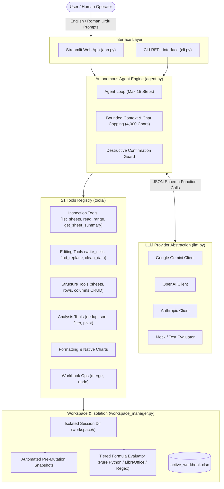
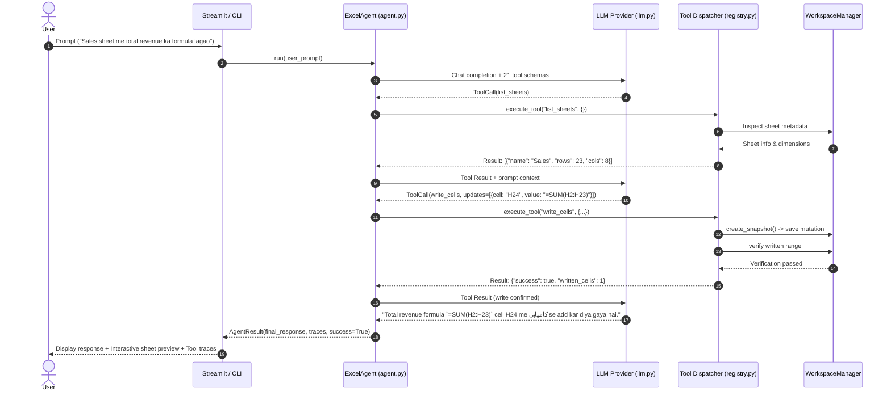
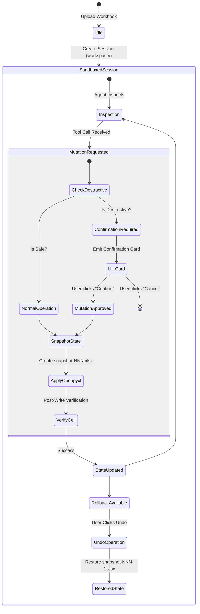
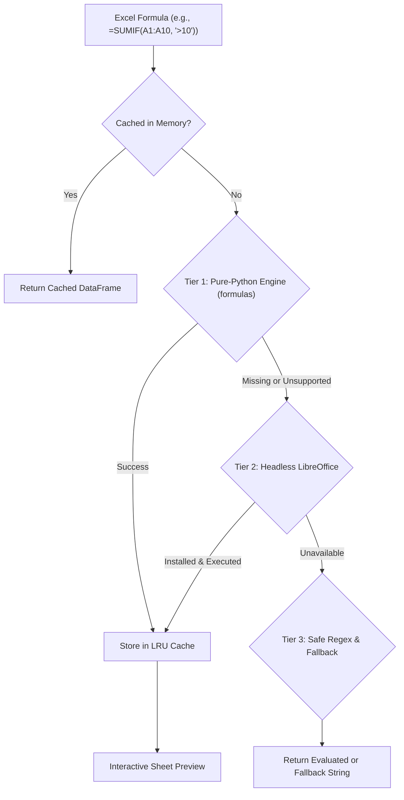

# 📋 Excel AI Agent — Technical & Functional Specification (SPEC.md)

**Document Version:** 1.0.0  
**Status:** Approved & Implemented  
**Target Architecture:** Python 3.11+ / Streamlit / openpyxl / LLM Function Calling  
**Supported Languages:** English, Roman Urdu (Urdu in Latin Script)

---

## 1. Executive Summary & Vision

### 1.1 Objective
The **Excel AI Agent** is an autonomous, production-grade spreadsheet manipulation and analysis agent designed to eliminate manual spreadsheet toil. It allows users to manage, calculate, reformat, clean, visualize, and analyze complex `.xlsx` workbooks using conversational natural language in both **English** and **Roman Urdu** (e.g., *"total sales nikalo"*, *"duplicates hata do"*, *"region ke hisaab se chart banao"*).

### 1.2 Core Design Principles
1. **Multilingual Roman Urdu Native**: First-class handling of natural Roman Urdu idioms, spreadsheet domain vocabulary, and bilingual prompt queries without transliteration friction.
2. **Deterministic Safety & Non-Destructive Mutations**: The user's original file is never directly modified. All operations take place in isolated session workspaces with automated snapshots and single-step rollback.
3. **Inspection-First Execution**: The agent inspects sheet dimensions, headers, data distributions, and column types before proposing or performing mutations.
4. **Dynamic Formulas over Hardcoded Numbers**: The agent prioritizes native Excel formulas (`=SUM()`, `=AVERAGE()`, `=IF()`, `=SUMIF()`) to ensure spreadsheets remain dynamic, auditable, and reactive.
5. **Confirmation Guards**: Destructive operations (sheet drop, row/column purge, duplicate deletion) halt the autonomous loop to require explicit user confirmation.
6. **Provider Agnostic**: Seamlessly switches between Google Gemini (`gemini-3.8-flash`), OpenAI (`gpt-4o` / `gpt-6-luna`), Anthropic (`claude-haiku-5-5`), or a built-in deterministic Mock evaluation provider.

---

## 2. System Architecture

### 2.1 High-Level Component Architecture



### 2.2 Execution Sequence Diagram



---

## 3. Multilingual Agentic Flow & Prompt Engineering

### 3.1 Language Consistency Protocol
The agent detects whether the user's input is in **English** or **Roman Urdu** and is strictly instructed to return its final answer, status updates, and confirmation requests in the same linguistic mode:
- **English Query**: Responds with concise, professional English.
- **Roman Urdu Query**: Responds in natural, conversational Roman Urdu (e.g., *"Maine Sales sheet me total revenue ka formula `=SUM(H2:H23)` laga diya hai aur duplicate rows check kar li hain"*).

### 3.2 System Prompt Specification
```text
Role: Production-grade Excel AI Agent
Behavioral Directives:
1. Language Consistency: Always formulate responses in the exact language of user prompt.
2. Inspection First: Before mutating, call `list_sheets`, `get_sheet_summary`, or `read_range`.
3. Tool Calling Enforcement: Never reply with conversational plans alone when actions are required; invoke tools.
4. Prefer Live Formulas: Always prefer dynamic formulas (e.g., =SUM(), =AVERAGE(), =F2*G2) over pre-calculated static numbers.
5. Destructive Safety: Delete actions require user confirmation. Supply confirmed=True only after human consent.
6. Error Self-Correction: On formula or range failure, read back the error trace, adjust bounds, and re-attempt.
7. Final Summary: Present concise summary of modified cells and sheets upon completion.
```

### 3.3 Autonomous Execution Loop Safeguards
- **Max Steps Ceiling**: Enforces a strict upper bound of `15 steps` per prompt to prevent infinite hallucination or loop thrashing.
- **Sliding History Window**: Maintains up to 25 conversational turns while pruning older messages cleanly without severing tool call/result pairs.
- **Token Conservation via String Truncation**: Tool outputs are serialized and capped at `4,000 characters`. For large range inspections, rows are sampled and truncated gracefully with informative summaries.

---

## 4. Comprehensive Tools Specification (21 Built-in Tools)

The agent exposes 21 granular tools divided into 6 distinct functional domains:

### 4.1 Inspection Tools

| Tool Name | Parameters | Description | Return Payload |
|---|---|---|---|
| `list_sheets` | None | Lists all sheets in the active workbook with row/column dimensions and active sheet name. | `{"sheets": [{"name": str, "max_row": int, "max_column": int}], "active_sheet": str}` |
| `read_range` | `sheet_name?: str`<br/>`cell_range?: str`<br/>`max_rows?: int = 50`<br/>`show_formulas?: bool = True` | Reads cell coordinates, computed values, or underlying Excel formulas from a rectangular block. | `{"sheet": str, "range": str, "row_count": int, "rows": List[List[Any]]}` |
| `get_sheet_summary` | `sheet_name?: str`<br/>`max_sample_rows?: int = 5` | Computes column headers, inferred data types, null count metrics, and head sample rows. | `{"total_rows": int, "total_columns": int, "columns": List[dict], "sample_rows": list}` |

### 4.2 Editing Tools

| Tool Name | Parameters | Description | Return Payload |
|---|---|---|---|
| `write_cells` | `updates?: List[dict]`<br/>`cell?: str`<br/>`value?: str`<br/>`sheet_name?: str` | Writes values or formulas to specific cells. Automatically triggers post-write read verification. | `{"success": bool, "written_cells": int, "verified": bool}` |
| `find_and_replace` | `find_text: str`<br/>`replace_text: str`<br/>`sheet_name?: str`<br/>`match_case?: bool = False`<br/>`whole_cell?: bool = False`<br/>`columns?: List[str]` | Searches and substitutes strings/numbers across the active sheet or restricted columns. | `{"matches_replaced": int, "sheet": str}` |
| `clean_data` | `sheet_name?: str`<br/>`columns?: List[str]`<br/>`trim_spaces?: bool = True`<br/>`fix_casing?: 'title'\|'lower'\|'upper'`<br/>`convert_types?: bool = True` | Strips whitespace, standardizes text capitalization, and casts text-encoded numbers/dates. | `{"rows_cleaned": int, "modifications": dict}` |

### 4.3 Structure Tools

| Tool Name | Parameters | Description | Safety Level |
|---|---|---|---|
| `create_sheet` | `title: str`, `index?: int` | Creates a new blank worksheet at the given tab index. | Safe |
| `rename_sheet` | `old_title: str`, `new_title: str` | Renames an existing worksheet tab. | Safe |
| `delete_sheet` | `title: str`, `confirmed?: bool = False` | Purges an entire sheet from the workbook. | **Destructive (Guard Required)** |
| `insert_rows` | `row_idx: int`, `count?: int = 1`, `sheet_name?: str` | Inserts one or more blank rows before `row_idx`. | Safe |
| `delete_rows` | `row_idx: int`, `count?: int = 1`, `sheet_name?: str`, `confirmed?: bool = False` | Deletes a sequence of rows. | **Destructive (Guard Required)** |
| `insert_columns` | `col_idx: str\|int`, `count?: int = 1`, `sheet_name?: str` | Inserts blank column(s) before `col_idx`. | Safe |
| `delete_columns` | `col_idx: str\|int`, `count?: int = 1`, `sheet_name?: str`, `confirmed?: bool = False` | Deletes column(s) starting from `col_idx`. | **Destructive (Guard Required)** |

### 4.4 Analysis & Aggregation Tools

| Tool Name | Parameters | Description | Safety Level |
|---|---|---|---|
| `remove_duplicates` | `columns?: List[str]`, `keep?: 'first'\|'last'`, `sheet_name?: str`, `confirmed?: bool = False` | Identifies and purges duplicate rows based on subset keys. | **Destructive (Guard Required)** |
| `sort_data` | `by_columns: str\|List[str]`, `ascending?: bool = True`, `has_headers?: bool = True`, `sheet_name?: str` | Sorts data rows by single or multiple column order. | Safe |
| `filter_data` | `column: str`, `condition: str`, `value: str`, `output_sheet?: str`, `sheet_name?: str` | Evaluates criteria (`equals`, `contains`, `greater_than`, etc.) and optionally writes to a target tab. | Safe |
| `create_pivot_summary` | `index_columns: str\|list`, `values_column: str`, `aggfunc?: str = 'sum'`, `output_sheet?: str` | Aggregates tabular metrics (sum, mean, count, min, max) onto a dedicated summary sheet. | Safe |

### 4.5 Formatting & Visualization Tools

| Tool Name | Parameters | Description |
|---|---|---|
| `format_range` | `cell_range: str`, `bold?: bool`, `italic?: bool`, `font_color?: str (HEX)`, `bg_color?: str (HEX)`, `font_size?: int`, `number_format?: str`, `border?: str`, `align_horizontal?: str`, `auto_fit_columns?: bool` | Applies professional styling, header tints, border lines, currency/percentage number formatting, and column width auto-fit. |
| `add_chart` | `chart_type: 'bar'\|'column'\|'line'\|'pie'`, `data_range: str`, `categories_range?: str`, `title?: str`, `target_cell?: str = 'K2'`, `x_title?: str`, `y_title?: str` | Generates native Excel OpenXML charts embedded directly into the spreadsheet canvas. |

### 4.6 Workbook Operations & Recovery

| Tool Name | Parameters | Description |
|---|---|---|
| `merge_workbooks` | `source_files: List[str]`, `mode?: 'add_sheets'\|'append_rows'`, `target_sheet_names?: List[str]` | Merges worksheets or appends tabular records from auxiliary Excel or CSV workbooks. |
| `undo_last_change` | None | Reverts the last mutating action and restores the previous workbook snapshot. |

---

## 5. Safety, Sandboxing & Integrity Architecture



### 5.1 Storage Sandboxing
- Every user session is allotted a distinct UUID workspace directory: `workspace/<session_id>/`.
- The user's uploaded file is cloned as `active_workbook.xlsx` inside the isolated workspace.
- The original source file is marked read-only and never modified.
- Stale workspaces exceeding `EXCEL_SESSION_MAX_AGE_HOURS` (default: 24 hours) are automatically purged during startup.

### 5.2 Pre-Mutation Snapshotting & Single-Step Undo
- Before any modifying tool executes, `WorkspaceManager.create_snapshot()` saves the current workbook state to an incremental snapshot stack: `snapshot_001.xlsx`, `snapshot_002.xlsx`, etc.
- Undo operations decrement the stack and restore the exact prior state without data corruption.
- The UI exposes a live undo counter indicating remaining reversible operations.

### 5.3 Bound Destructive Confirmation Guards
- Operations that remove data (`delete_sheet`, `delete_rows`, `delete_columns`, `remove_duplicates`) require explicit confirmation.
- When invoked without `confirmed=True`, the tool runs in simulation mode, calculating exact rows, columns, or sheets to be affected, and flags `requires_confirmation: True`.
- The agent pauses and presents an interactive confirmation modal in the UI.
- The execution engine strictly binds to the exact approved arguments to prevent LLM hallucination of secondary targets.

### 5.4 Post-Write Verification
- When `write_cells` writes formulas or values, it immediately re-reads the modified coordinates using openpyxl.
- If the value does not match expectations or yields a syntax error, the tool reports a failure to the agent loop, triggering immediate self-correction.

---

## 6. Tiered Live Formula Engine

Spreadsheets must display evaluated formulas to the user in the Streamlit preview. The Excel AI Agent employs a **3-tier evaluation strategy**:



1. **Tier 1 — Pure-Python `formulas` Parser**:
   Evaluates functions including `SUM`, `AVERAGE`, `IF`, `COUNT`, `SUMIF`, `MAX`, `MIN`, and algebraic expressions directly in Python memory.
2. **Tier 2 — Headless LibreOffice Integration**:
   If LibreOffice is detected on `PATH`, the manager invokes headless recalculation for complex multi-sheet references and advanced financial functions.
3. **Tier 3 — Regex Arithmetic & Graceful Degrade**:
   If engines are unavailable, basic arithmetic is computed via AST parsing, while complex formulas degrade gracefully without crashing UI serialization.
4. **Cache Invalidation**:
   The evaluated formula cache is automatically invalidated whenever a mutating tool executes or a snapshot is restored.

---

## 7. Dual Interface Specifications

### 7.1 Streamlit Web UI (`app.py`)
- **Main Canvas**: Live interactive spreadsheet table with sheet tab selector, row metrics, formula view toggle, and CSV/XLSX export downloads.
- **Docked AI Assistant**: Modern glassmorphism floating corner chatbot interface with avatar badges, smooth toggle animations, and conversational continuity.
- **Collapsible Tool Traces**: Every tool invocation displays expandable details with input parameters, JSON responses, execution duration, and status indicators.
- **Quick Action Pills**: Pre-configured one-click prompt pills for instant evaluation:
  - *"Show summary"*
  - *"Calculate totals"*
  - *"Find duplicates"*
  - *"Format headers"*
  - *"Clean text"*
  - *"Create chart"*
- **Sample Dataset Loader**: Instantly loads sample data (`sales.xlsx`) for evaluation without uploading files.

### 7.2 Terminal CLI REPL (`cli.py`)
- Interactive command-line loop: `python cli.py [workbook.xlsx]`.
- Formatted tabular data preview using `tabulate`.
- Real-time tool execution logs directly in stdout.
- Support for CLI flags (`--provider`, `--model`, `--max-steps`).

---

## 8. Verification & Quality Assurance (Pytest Suite)

The codebase is backed by a modular pytest test suite with **54 automated unit and integration tests**:

| Test Module | Coverage Scope | Test Count |
|---|---|---|
| `tests/test_inspection.py` | Sheet listing, range reading, headers, type inference, 50k+ row safety | 5 |
| `tests/test_editing.py` | Cell writes, formula insertion, find-and-replace, text normalization | 4 |
| `tests/test_structure.py` | Sheet create/rename/delete, row/column insertion & deletion guards | 4 |
| `tests/test_analysis.py` | Duplicate removal, ascending/descending sorting, conditional filtering, pivot aggregation | 4 |
| `tests/test_formatting_and_chart.py` | Cell styles, fonts, borders, number formatting, bar/pie chart generation | 2 |
| `tests/test_formulas.py` | Live formula evaluation, SUM/AVERAGE/IF nested functions, cache hits/invalidation | 17 |
| `tests/test_ui_escaping.py` | XSS prevention, markdown escaping, Streamlit raw HTML sanitization | 3 |
| `tests/test_cleanup_and_uploads.py` | Session directory creation, filename sanitization, stale workspace purging | 4 |
| `tests/test_workbook_ops.py` | Multi-workbook merging (sheets and appended rows), single-step undo recovery | 3 |
| `tests/test_agent_loop.py` | Autonomous step limits, provider routing, Roman Urdu handling, error self-correction | 11 |

### Continuous Integration (CI/CD)
- **Workflow**: `.github/workflows/ci.yml`
- **Matrix**: Ubuntu Latest with Python `3.11` and `3.12`.
- **Validation Gates**: Automated dependency installation, linter check, and test suite execution on every pull request and push to `main`.

---

## 9. Configuration & Deployment

### 9.1 Environment Variables (`.env`)
```bash
# LLM Providers (At least one required for live LLM mode; defaults to mock if missing)
GEMINI_API_KEY=your_gemini_api_key_here
OPENAI_API_KEY=your_openai_api_key_here
ANTHROPIC_API_KEY=your_anthropic_api_key_here

# Active Provider Selection (gemini | openai | anthropic | mock)
DEFAULT_LLM_PROVIDER=gemini

# Model Names
GEMINI_MODEL=gemini-3.8-flash
OPENAI_MODEL=gpt-4o
ANTHROPIC_MODEL=claude-3-5-haiku-20241022

# Workspace & Safety Settings
EXCEL_WORKSPACE_DIR=workspace
EXCEL_SESSION_MAX_AGE_HOURS=24
EXCEL_MAX_STEPS=15
EXCEL_MAX_OUTPUT_CHARS=4000
```

### 9.2 Deployment Targets
- **Streamlit Community Cloud**: Configured via `.streamlit/config.toml` and `requirements.txt`.
- **Docker / Cloud Run**: Can be containerized with Python 3.11-slim base image.
- **Local / On-Premise**: Standard virtual environment execution via `sync.bat` or `python -m venv .venv`.

---

## 10. Conclusion & Compliance
This specification document serves as the canonical technical standard for the Excel AI Agent repository. Any architectural modifications, new tool implementations, or provider integrations must comply with the safety invariants, multilingual guarantees, and testing protocols outlined herein.
