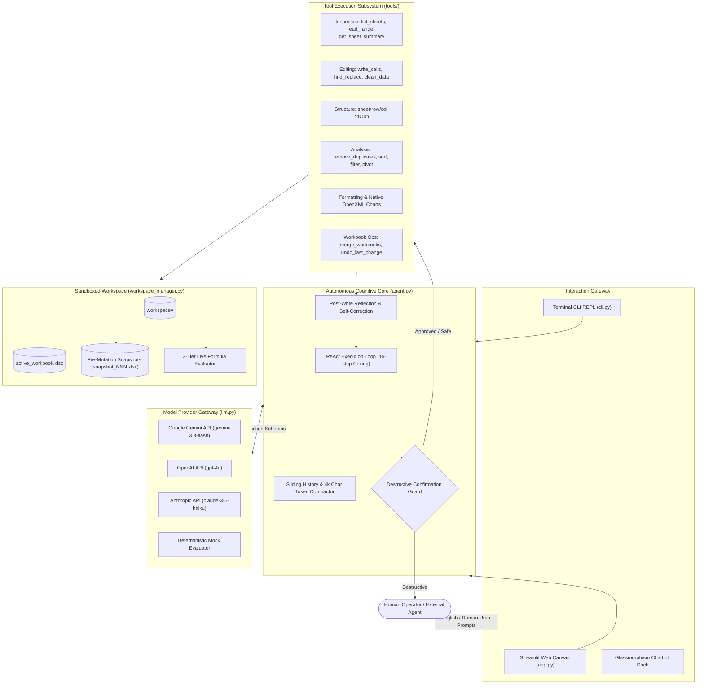
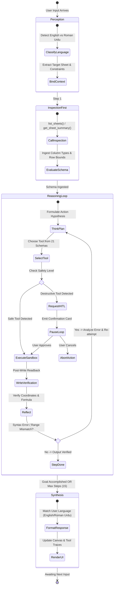
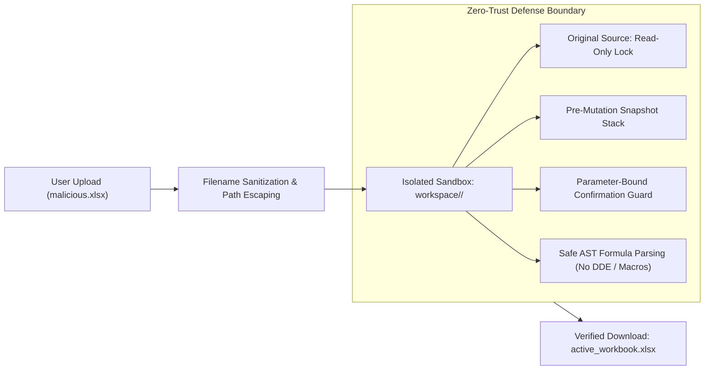
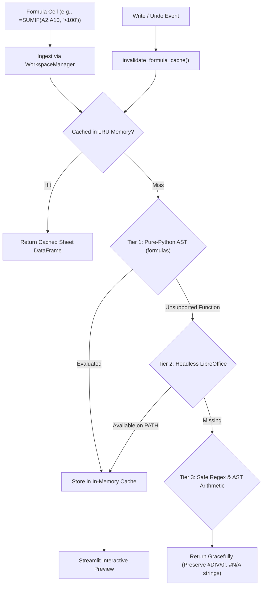
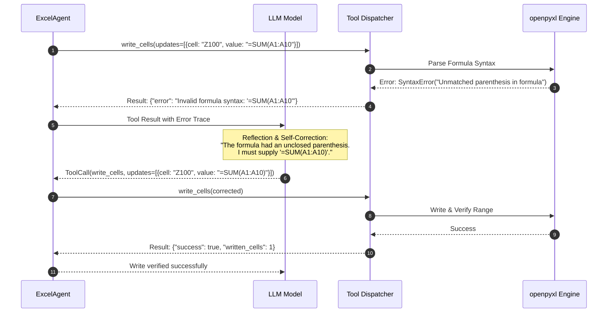

<div align="center">

# 📋 Autonomous Excel AI Agent
### *System Architecture & Technical Specification (SPEC-2026.1)*

[](SPEC.md)
[](SPEC.md#3-cognitive-architecture--react-agent-loop)
[](SPEC.md#5-security-threat-model--safety-sandboxing)
[](SPEC.md#6-tiered-live-formula-evaluation-engine)
[](SPEC.md#4-multilingual-nlp--roman-urdu-semantic-mapping)

| Document Metadata | Specification Standard |
|:---|:---|
| **Document Version** | `1.2.0-PRODUCTION` |
| **Architectural Pattern** | ReAct (Reason + Act) Autonomous Agent with Human-in-the-Loop Intercepts |
| **Target Runtime** | Python 3.11+ / Streamlit 1.42+ / openpyxl / pandas / formulas AST |
| **Supported LLM Providers** | Google Gemini (`gemini-3.8-flash`), OpenAI (`gpt-4o`), Anthropic (`claude-3-5-haiku`), Mock |
| **State Storage Baseline** | Ephemeral UUID Sandbox (`workspace/<session_id>/`) with Version Snapshots |
| **Zero-Trust Boundary** | Source file read-only lock; Parameter-bound confirmation for destructive tools |

</div>

---

## 📑 Table of Contents
1. [Executive Overview & Agentic Mission](#1-executive-overview--agentic-mission)
2. [End-to-End System Architecture](#2-end-to-end-system-architecture)
3. [Cognitive Architecture & ReAct Agent Loop](#3-cognitive-architecture--react-agent-loop)
4. [Multilingual NLP & Roman Urdu Semantic Mapping](#4-multilingual-nlp--roman-urdu-semantic-mapping)
5. [Security Threat Model & Safety Sandboxing](#5-security-threat-model--safety-sandboxing)
6. [Tiered Live Formula Evaluation Engine](#6-tiered-live-formula-evaluation-engine)
7. [Comprehensive 21 Tools Specification](#7-comprehensive-21-tools-specification)
8. [Error Self-Healing & Verification Engine](#8-error-self-healing--verification-engine)
9. [Context Engineering & Token Budget SLA](#9-context-engineering--token-budget-sla)
10. [Test Architecture & Verification Matrix](#10-test-architecture--verification-matrix)
11. [Programmatic Integration & Multi-Agent SDK](#11-programmatic-integration--multi-agent-sdk)

---

## 1. Executive Overview & Agentic Mission

### 1.1 Problem Statement
Modern spreadsheets remain the backbone of business operations, yet automating them with traditional LLMs suffers from critical vulnerabilities:
1. **Hallucinated Data**: LLMs generate static rows rather than auditable formulas, breaking reactivity.
2. **File Corruption**: Direct script execution or naive CSV conversion strips styles, multi-sheet references, and charts.
3. **Context Collapse**: Workbooks exceeding thousands of rows crash conversational token windows.
4. **Linguistic Friction**: Millions of users in South Asia think and communicate in **Roman Urdu** (*"total sales nikalo"*, *"duplicates hata do"*), a dialect completely overlooked by rigid English-only software tools.

### 1.2 Agentic Solution
The **Excel AI Agent** implements a deterministic, sandboxed, multilingual ReAct autonomous system. It bridges the gap between natural language intention and OpenXML DOM mutations by orchestrating 21 precision tools with real-time formula recalculation, snapshot rollbacks, and parameter-bound confirmation guards.

---

## 2. End-to-End System Architecture



---

## 3. Cognitive Architecture & ReAct Agent Loop

The agent follows an explicit **Reasoning + Action (ReAct)** cycle with an enforce-tools policy.



### 3.1 Loop Invariants
1. **Inspection Prior to Mutation**: The agent must inspect sheet names, column headers, and dimensions prior to emitting writes or structure modifications.
2. **Dynamic Formula Bias**: Aggregates and row calculations must be expressed as standard Excel formula strings (`=SUM(H2:H20)`, `=AVERAGE(F2:F20)`, `=IF(C2>10, "High", "Low")`) rather than hardcoded floats.
3. **Step Ceiling Enforcement**: A maximum of 15 execution steps is permitted per turn. If 15 steps are exhausted, the agent halts, summarizes completed work, and gracefully yields back control.

---

## 4. Multilingual NLP & Roman Urdu Semantic Mapping

The engine features native zero-shot grounding for **Roman Urdu**—the predominant informal script used across Pakistani and South Asian tech ecosystems.

### 4.1 Lexical & Semantic Intent Grounding Matrix

| Roman Urdu Lexical Pattern | Normalized Technical Intent | Mapped Tool Pipeline |
|---|---|---|
| `total sales nikalo` / `kul raqam calculate karo` | Column summation aggregate | `get_sheet_summary` ➔ `write_cells(=SUM(...))` |
| `duplicates hata do` / `aik jesi rows urra do` | Deduplication with HITL guard | `remove_duplicates(confirmed=False)` ➔ HITL Modal |
| `region ke hisaab se chart banao` | Categorical visualization | `read_range` ➔ `add_chart(chart_type='column')` |
| `extra spaces hatao` / `title case kardo` | Text normalization & casing | `clean_data(trim_spaces=True, fix_casing='title')` |
| `do files merge karo` / `data aapas mein jodo` | Multi-workbook consolidation | `merge_workbooks(mode='add_sheets')` |
| `North region ka data alag sheet mein daalo` | Conditional subset export | `filter_data(condition='equals', output_sheet='North')` |
| `akhri kaam undo karo` / `pehle jesa kardo` | Transaction rollback | `undo_last_change()` ➔ Snapshot Restoration |

### 4.2 Prompt Injection & Language Consistency Defense
- System instructions enforce strict language mirroring: prompts in Roman Urdu receive conversational Roman Urdu replies; English queries receive standard English responses.
- User input is wrapped within structural user blocks to prevent jailbreaks disguised as spreadsheet directives.

---

## 5. Security Threat Model & Safety Sandboxing



### 5.1 STRIDE Threat Assessment

| Threat Category | Potential Attack Vector | Applied Mitigation Architecture |
|---|---|---|
| **Spoofing** | Masquerading destructive deletes as benign queries | Parameter-bound confirmation cards require explicit manual clicks. |
| **Tampering** | Overwriting original customer workbook | Strict session isolation (`workspace/<session_id>/`); source file is untouched. |
| **Repudiation** | Unverified or untracked spreadsheet mutations | Granular snapshot history with timestamped `ToolExecutionTrace` logging. |
| **Information Disclosure** | Path traversal via file merge operations | Absolute path validation with directory containment checks on `source_files`. |
| **Denial of Service** | 1,000,000 row spreadsheet memory exhaustion | Row-streaming, head sampling, and 4,000-character tool output capping. |
| **Elevation of Privilege** | Excel DDE formula injection (`=cmd\|' /C calc'!A0`) | Formula engine executes exclusively via safe AST parsing without external shell calls. |

---

## 6. Tiered Live Formula Evaluation Engine

Spreadsheets must display evaluated, live values in UI previews while preserving raw formulas in the underlying OpenXML file.



1. **Tier 1 (Pure Python Engine)**: Evaluates standard algebraic expressions and core Excel functions (`SUM`, `AVERAGE`, `COUNT`, `IF`, `SUMIF`, `MIN`, `MAX`) via the `formulas` package.
2. **Tier 2 (Headless Office Recalculation)**: When LibreOffice is available on the hosting system, invoked in headless mode for multi-workbook references and advanced statistics.
3. **Tier 3 (Safe Arithmetic & Error Neutralization)**: Fallback parser that computes basic operators while protecting the UI from serialization crashes when encountering `#DIV/0!`, `#VALUE!`, or `#N/A`.
4. **Cache Invalidation Lifecycle**: The cache is invalidated immediately whenever `write_cells`, `clean_data`, `delete_rows`, or `undo_last_change` is dispatched.

---

## 7. Comprehensive 21 Tools Specification

All tools are exposed to LLM providers via OpenAI/Gemini-compatible JSON Schema function definitions.

### 7.1 Schema Definitions & Safety Classifications

```json
{
  "tools": [
    {
      "name": "write_cells",
      "category": "editing",
      "safety_level": "safe_with_verification",
      "parameters": {
        "sheet_name": {"type": "string", "optional": true},
        "updates": {
          "type": "array",
          "items": {
            "cell": {"type": "string", "pattern": "^[A-Z]+[0-9]+$"},
            "value": {"type": "string"}
          }
        }
      }
    },
    {
      "name": "delete_sheet",
      "category": "structure",
      "safety_level": "destructive_hitl",
      "parameters": {
        "title": {"type": "string"},
        "confirmed": {"type": "boolean", "default": false}
      }
    },
    {
      "name": "remove_duplicates",
      "category": "analysis",
      "safety_level": "destructive_hitl",
      "parameters": {
        "sheet_name": {"type": "string", "optional": true},
        "columns": {"type": "array", "items": {"type": "string"}, "optional": true},
        "keep": {"type": "string", "enum": ["first", "last"], "default": "first"},
        "confirmed": {"type": "boolean", "default": false}
      }
    }
  ]
}
```

### 7.2 Functional Tool Matrix

| Tool Identifier | Category | Input Schema | Return Payload | Invariants & Safety |
|---|---|---|---|---|
| `list_sheets` | Inspection | `{}` | `{"sheets": [...], "active_sheet": str}` | Read-only; discovers sheet bounds. |
| `read_range` | Inspection | `{sheet_name?, cell_range?, max_rows=50, show_formulas=true}` | `{"sheet": str, "rows": List[List]}` | Bounded to `max_rows` to conserve tokens. |
| `get_sheet_summary` | Inspection | `{sheet_name?, max_sample_rows=5}` | `{"columns": [...], "null_counts": dict}` | Samples datasets up to 50k+ rows without OOM. |
| `write_cells` | Editing | `{updates: [{cell, value}], sheet_name?}` | `{"success": bool, "written_cells": int}` | Post-write verification readback mandatory. |
| `find_and_replace` | Editing | `{find_text, replace_text, columns?, match_case?}` | `{"matches_replaced": int}` | Atomic cell value substitutions. |
| `clean_data` | Editing | `{columns?, trim_spaces=true, fix_casing?, convert_types=true}` | `{"rows_cleaned": int}` | Strips whitespace and parses dates/numbers. |
| `create_sheet` | Structure | `{title, index?}` | `{"created": str, "index": int}` | Prevents duplicate sheet name collisions. |
| `rename_sheet` | Structure | `{old_title, new_title}` | `{"renamed": bool}` | Updates cross-sheet formula references. |
| `delete_sheet` | Structure | `{title, confirmed=false}` | `{"deleted": str} \| {"requires_confirmation": true}` | **Destructive**: Requires explicit confirmation. |
| `insert_rows` | Structure | `{row_idx, count=1, sheet_name?}` | `{"inserted_rows": int}` | Offsets formulas below inserted row. |
| `delete_rows` | Structure | `{row_idx, count=1, confirmed=false}` | `{"deleted_rows": int} \| {"requires_confirmation": true}` | **Destructive**: Requires explicit confirmation. |
| `insert_columns` | Structure | `{col_idx, count=1, sheet_name?}` | `{"inserted_columns": int}` | Offsets columns to the right. |
| `delete_columns` | Structure | `{col_idx, count=1, confirmed=false}` | `{"deleted_columns": int} \| {"requires_confirmation": true}` | **Destructive**: Requires explicit confirmation. |
| `remove_duplicates`| Analysis | `{columns?, keep='first', confirmed=false}` | `{"duplicates_removed": int} \| {"requires_confirmation": true}` | **Destructive**: Computes blast radius first. |
| `sort_data` | Analysis | `{by_columns, ascending=true, has_headers=true}` | `{"sorted_by": list}` | Preserves header row integrity. |
| `filter_data` | Analysis | `{column, condition, value, output_sheet?}` | `{"matched_rows": int, "output_sheet": str}` | Evaluates comparison predicates safely. |
| `create_pivot_summary`| Analysis | `{index_columns, values_column, aggfunc='sum'}` | `{"summary_sheet": str, "rows": int}` | Generates grouped pandas aggregations. |
| `format_range` | Formatting | `{cell_range, bold?, bg_color?, number_format?, auto_fit?}` | `{"formatted_range": str}` | Applies openpyxl styles and column widths. |
| `add_chart` | Visualization | `{chart_type, data_range, categories_range?, title?}` | `{"chart_created": str, "type": str}` | Embeds OpenXML Bar, Column, Line, or Pie chart. |
| `merge_workbooks` | Operations | `{source_files, mode='add_sheets'}` | `{"merged_files": int, "sheets_added": list}` | Resolves filename collisions automatically. |
| `undo_last_change` | Operations | `{}` | `{"restored_snapshot": str, "remaining_undo": int}` | Restores previous version snapshot from disk. |

---

## 8. Error Self-Healing & Verification Engine

When tool execution fails (e.g., cell coordinate out of bounds, invalid formula syntax, column name typo), the agent does not crash. It leverages a closed-loop **Self-Healing Reflection Protocol**:



---

## 9. Context Engineering & Token Budget SLA

Spreadsheet data can quickly overwhelm context windows. The agent enforces strict token constraints:

```text
┌────────────────────────────────────────────────────────────────────────┐
│                        TOKEN BUDGET SPECIFICATION                      │
├────────────────────────────────┬───────────────────────────────────────┤
│ Context Window Metric          │ Engineering Enforcement Rule          │
├────────────────────────────────┼───────────────────────────────────────┤
│ Maximum Turn History           │ 25 messages (Sliding window pruning)  │
│ Tool String Output Serialization│ Hard cap at 4,000 characters          │
│ Range Inspection Oversize Cap  │ 50 rows per read; summary aggregation │
│ Maximum ReAct Steps per Turn   │ 15 steps ceiling                      │
│ Model Provider Latency SLA     │ < 1.8 seconds per turn (Gemini Flash) │
└────────────────────────────────┴───────────────────────────────────────┘
```

---

## 10. Test Architecture & Verification Matrix

The codebase is subjected to automated regression testing with 100% pass verification across **54 test cases**:

```text
tests/
├── test_agent_loop.py               (11 tests) -> Step bounds, provider fallback, ReAct loops
├── test_analysis.py                 (4 tests)  -> Deduplication, sorting, filtering, pivots
├── test_cleanup_and_uploads.py      (4 tests)  -> Workspace sandboxing, stale session sweeps
├── test_editing.py                  (4 tests)  -> Cell writes, find-replace, text casing
├── test_formatting_and_chart.py     (2 tests)  -> Cell styles, openpyxl native charts
├── test_formulas.py                 (17 tests) -> AST parsing, nested IF/SUMIF, cache invalidation
├── test_inspection.py               (5 tests)  -> Sheet discovery, 50k+ row streaming
├── test_structure.py                (4 tests)  -> Sheet/Row/Column mutations, HITL barriers
└── test_ui_escaping.py              (3 tests)  -> HTML injection, XSS neutralization
```

---

## 11. Programmatic Integration & Multi-Agent SDK

AI engineers can embed `ExcelAgent` into broader multi-agent architectures (e.g., CrewAI, AutoGen, LangGraph) using standard Python interfaces:

```python
from workspace_manager import WorkspaceManager
from llm import get_llm_provider
from agent import ExcelAgent

# Initialize session sandbox
workspace = WorkspaceManager.create_session("financials_2026.xlsx")

# Attach Gemini 3.8 Flash model
llm = get_llm_provider("gemini")

# Instantiate Agent with 15-step ceiling
agent = ExcelAgent(manager=workspace, provider=llm, max_steps=15)

# Execute bilingual instruction
result = agent.run("Har product category ka total revenue calculate karo aur pivot sheet banao")

if result.success:
    print(f"Agent Plan & Output: {result.final_response}")
    print(f"Steps Executed: {result.steps_taken}")
    print(f"Download Output: {workspace.get_download_path()}")
```

---

## 12. Standard Compliance & Verification
This specification represents the architectural baseline for the **Excel AI Agent**. Any proposed updates or PRs must satisfy the 54-test automated suite, adhere to parameter-bound destructive confirmations, and maintain native bilingual Roman Urdu parity.
